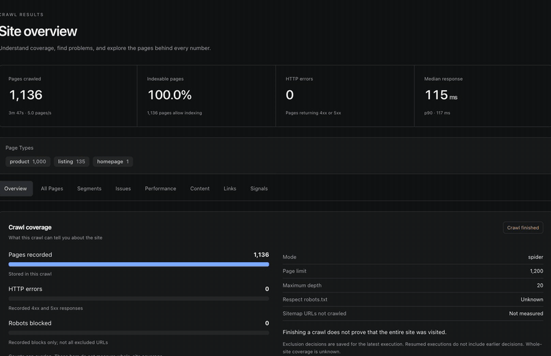
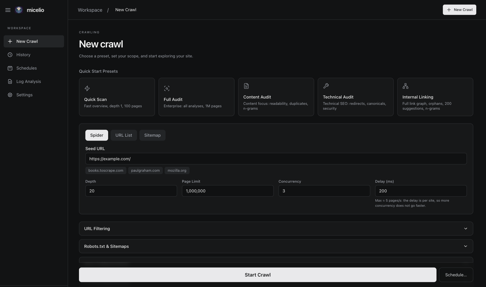
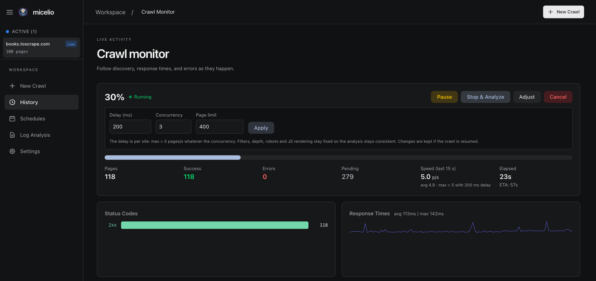
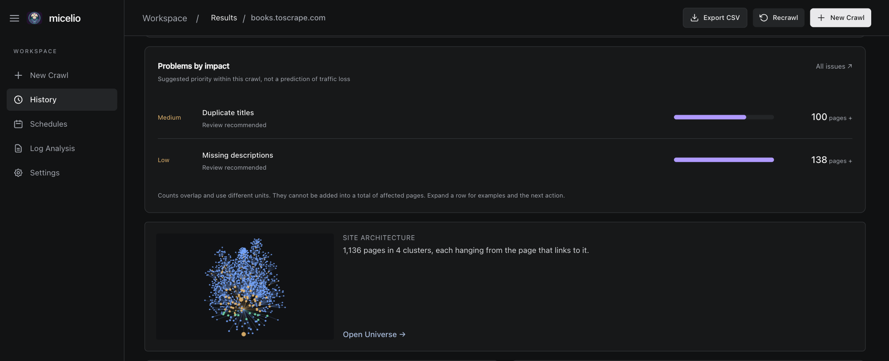
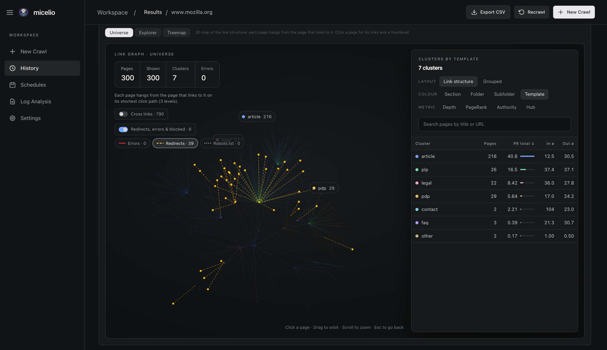
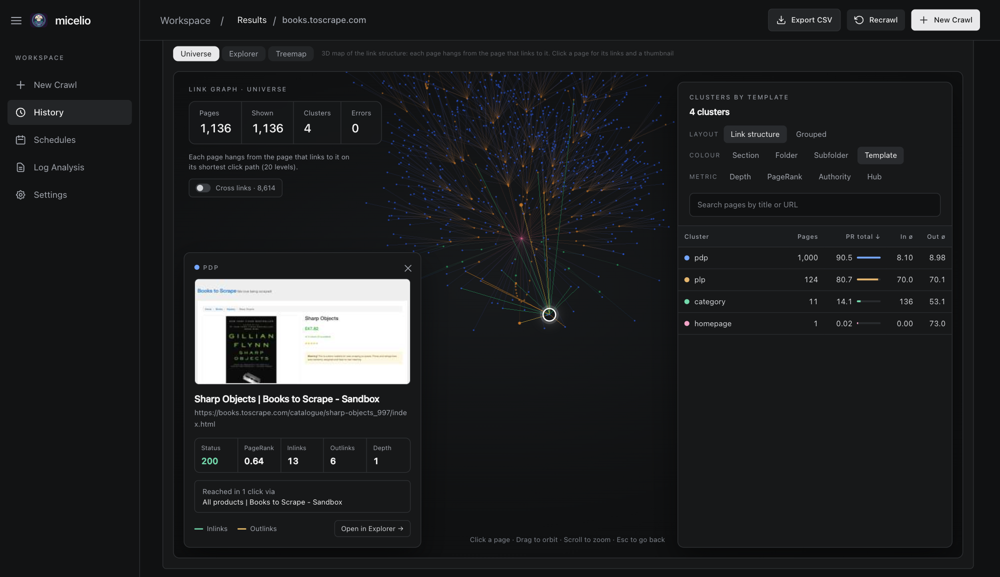
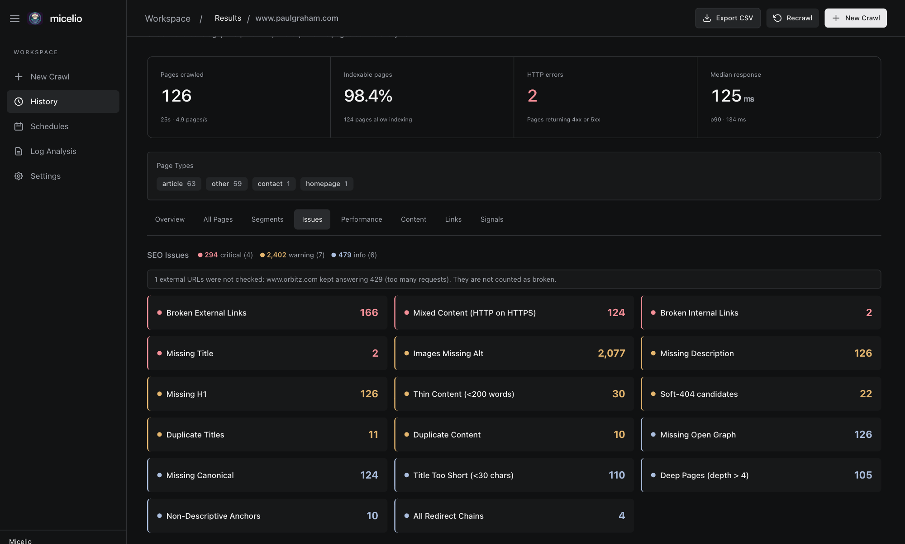

<p align="center">
  
</p>

<h1 align="center">Micelio</h1>

<p align="center">An SEO crawler that audits your site, maps its real link architecture and analyses your server logs. One binary with a web dashboard; your data stays on your machine.</p>

<p align="center">
  <a href="https://github.com/jlhernando/micelio-crawler/releases/latest"></a>
  <a href="LICENSE"></a>
</p>

<p align="center"><br><em>Universe: every dot is a page, every line a real internal link.</em></p>

## What it does

- **Technical SEO audit.** Crawl a site by following links (spider), from a URL list or from XML sitemaps. Issues are grouped as critical, warning and info, with the affected URLs: titles, canonicals, hreflang, redirects, soft-404 candidates, structured data, security headers and more.
- **See the real link architecture.** Universe draws the site as a 3D map of its internal links. Status pills light up errors, redirects and URLs blocked by robots.txt. Overview shows a mini map of the same architecture.
- **Change a running crawl.** Adjust the delay, concurrency and page limit without stopping. Stop & Analyze shows results in seconds.
- **Server log analysis.** Apache, Nginx, CloudFront, Cloudflare, ALB/ELB and W3C/IIS logs. 100+ bot signatures, crawl-budget waste, AI bot trends and a log-to-crawl merge.
- **Scheduled crawls with reports.** Cron schedules send reports by email, Telegram or Slack, and can check the network before each run.
- **Compare crawls.** History keeps every crawl; Diff shows added, removed and changed pages between two.
- **Integrations.** Google Search Console, GA4, PageSpeed Insights, CrUX, Plausible and AI analysis (OpenAI, Anthropic, Ollama).
- **Single binary, local data.** No server to run and no account. Crawls live in `~/.micelio` on your computer.

## Install

**Download a binary** for Linux, macOS or Windows (amd64 and arm64) from the [releases page](https://github.com/jlhernando/micelio-crawler/releases/latest):

```bash
# macOS (Apple Silicon)
curl -LO https://github.com/jlhernando/micelio-crawler/releases/latest/download/micelio-darwin-arm64
chmod +x micelio-darwin-arm64 && mv micelio-darwin-arm64 /usr/local/bin/micelio
xattr -d com.apple.quarantine /usr/local/bin/micelio   # binaries are unsigned
```

**Docker:**

```bash
docker build -t micelio .   # add --build-arg WITH_CHROMIUM=true for JS rendering
docker run -p 3100:3100 -v micelio-data:/home/micelio/.micelio micelio
```

**From source:**

```bash
git clone https://github.com/jlhernando/micelio-crawler.git && cd micelio-crawler
make build-with-dashboard   # or: make install
```

Then start the dashboard and open http://localhost:3100:

```bash
micelio ui
```

Prerequisites: none for the binary. Building needs Go 1.26+ and Node.js 20+. JS rendering needs Chrome or Chromium.

Each release has a `checksums.txt`, and the in-app updater checks it before it installs an update. See the [User Guide](docs/USER-GUIDE.md#install-and-verify).

## Screenshots

| | |
|---|---|
| <br>**New Crawl**: presets, crawl mode and limits | <br>**Monitor**: live progress, speed and the Adjust panel |
| <br>**Overview**: headline metrics, coverage and the site architecture map | <br>**Universe**: status pills light up errors, redirects or robots.txt |
| <br>**Page detail**: inlinks, outlinks, click path and a thumbnail | <br>**Issues**: critical, warning and info checks with page counts |

## CLI

| Command | Description |
|---------|-------------|
| `crawl <url>` | Spider crawl with full SEO analysis |
| `list <file>` | Crawl URLs from a text file (one URL per line) |
| `sitemap <url...>` | Crawl all URLs listed in XML sitemaps |
| `head <file>` | HEAD-only crawl for status codes and headers |
| `robots-test <url>` | Test robots.txt rules for 21 bot signatures |
| `verify-bot <ip...>` | Check if IPs belong to Google's crawlers |
| `diff <old.jsonl> <new.jsonl>` | Compare two crawl outputs |
| `generate-sitemap <file>` | Generate an XML sitemap from JSONL crawl output |
| `import <file>` | Add a crawl made elsewhere to the dashboard and analyse it |
| `schedule [url]` | Run crawls on a cron schedule with reports |
| `schedules` | List scheduled crawls and their status |
| `logs <file1> [file2...]` | Analyse server access logs |
| `gsc-auth` | OAuth2 sign-in for Google Search Console |
| `build` | Rebuild and install Micelio from source |
| `ui` | Start the web dashboard |

```bash
micelio crawl https://example.com --max-pages 5000 --link-intelligence --html
micelio sitemap https://example.com/sitemap.xml -l 50000 -o sitemap-crawl.jsonl
micelio logs access-*.log --output bots.json
micelio schedule https://example.com --cron "0 2 * * *" --webhook https://hooks.slack.com/...
```

Every command and flag is in the [CLI Reference](docs/CLI-REFERENCE.md).

## Documentation

- [User Guide](docs/USER-GUIDE.md): every screen of the dashboard, by workflow
- [CLI Reference](docs/CLI-REFERENCE.md): every command, flag and example
- [Crawl in the cloud](docs/CLOUD-CRAWLS.md): crawl on a small server, analyse on your computer
- [Memory management](docs/MEMORY-MANAGEMENT.md): how Micelio keeps memory bounded on large crawls
- [Architecture](docs/ARCHITECTURE.md): stack, project layout and performance internals
- [Contributing](CONTRIBUTING.md): build, test and release
- [Changelog](CHANGELOG.md): what changed in each version

## License

[MIT](LICENSE)
