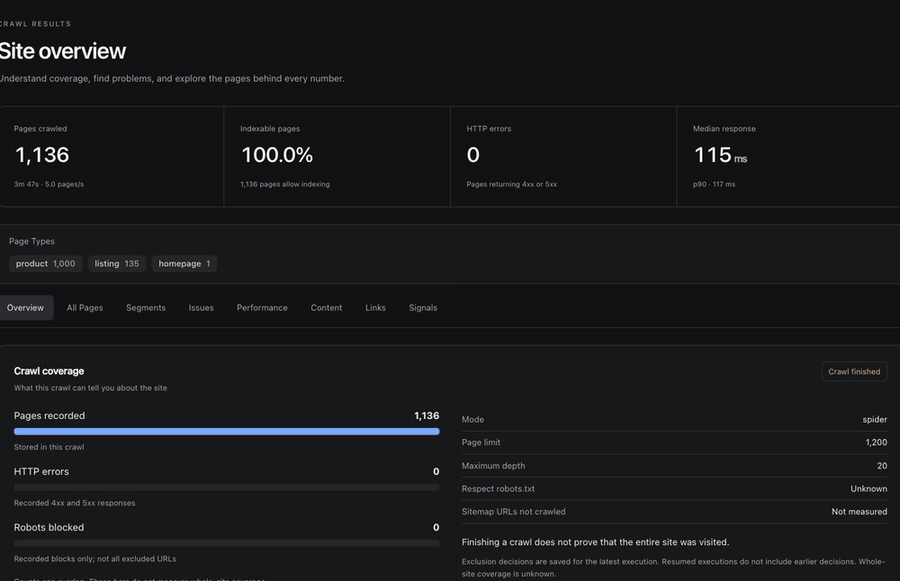
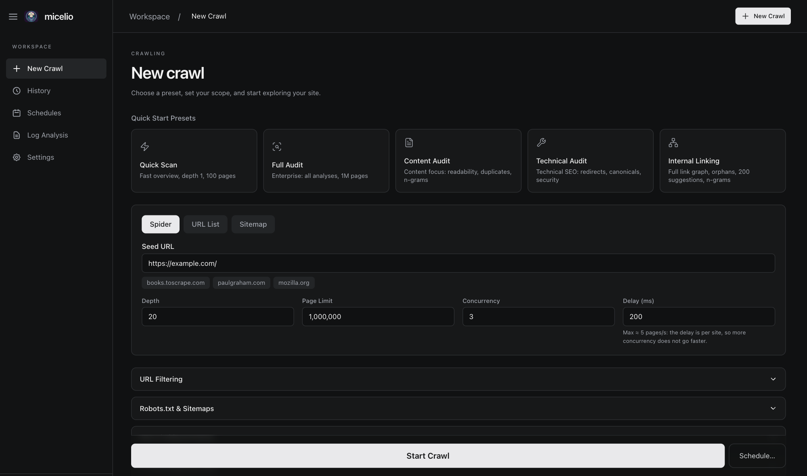
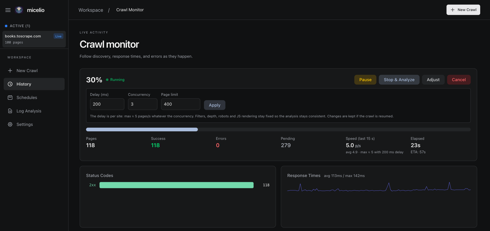
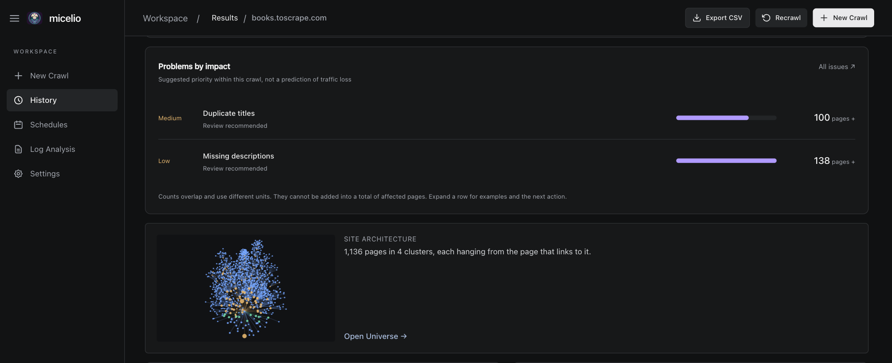
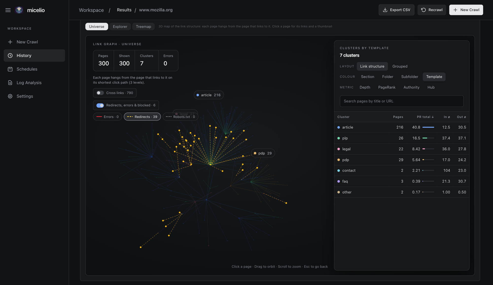
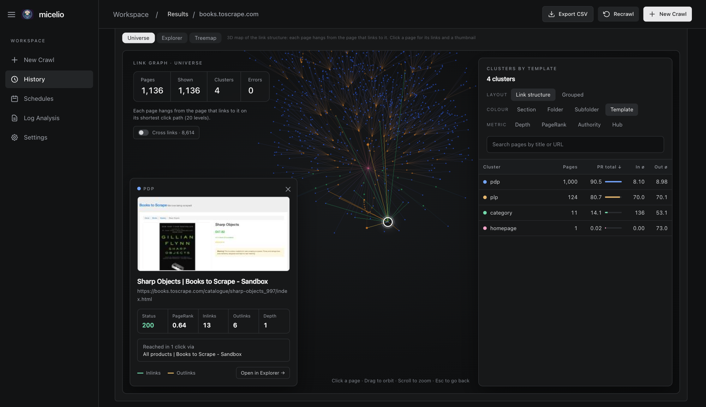
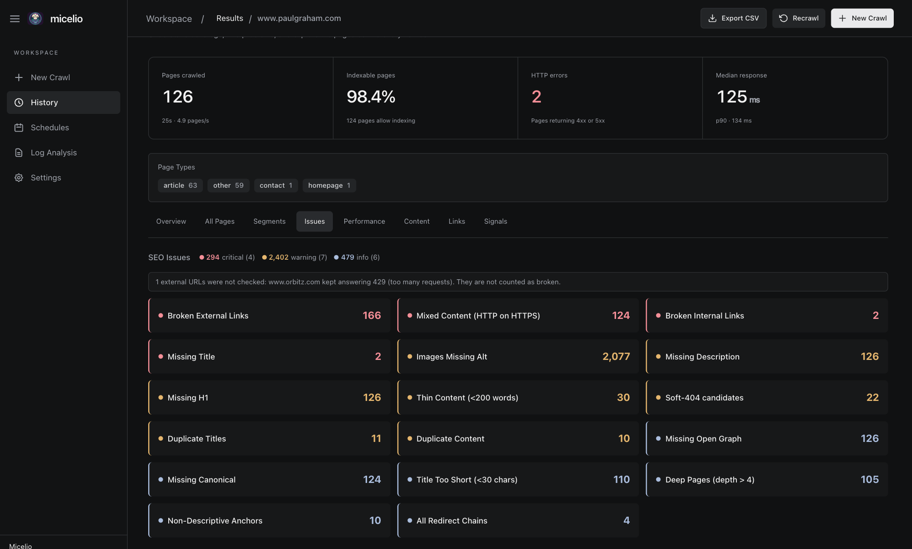

<p align="center">
  
</p>

<h1 align="center">Micelio</h1>

<p align="center">An open-source SEO crawler with a local web dashboard. Find technical SEO issues, explore internal links and analyse server logs. Connect an AI agent through MCP.</p>

<p align="center">
  <a href="#download">Download</a> ·
  <a href="#your-first-crawl">Your first crawl</a> ·
  <a href="docs/USER-GUIDE.md">User guide</a> ·
  <a href="docs/MCP.md">Connect an AI agent</a> ·
  <a href="https://miceliocrawler.com">Website</a>
</p>

<p align="center">
  <a href="https://github.com/jlhernando/micelio-crawler/releases/latest"></a>
  <a href="LICENSE"></a>
</p>

<p align="center"><br><em>Universe: every dot is a page, every line a real internal link.</em></p>

## Download

Choose your operating system and processor. These executables start the web dashboard; they are not desktop installers.

| System | Download |
|---|---|
| macOS | [Apple Silicon](https://github.com/jlhernando/micelio-crawler/releases/latest/download/micelio-darwin-arm64) · [Intel](https://github.com/jlhernando/micelio-crawler/releases/latest/download/micelio-darwin-amd64) |
| Windows | [x64](https://github.com/jlhernando/micelio-crawler/releases/latest/download/micelio-windows-amd64.exe) · [ARM64](https://github.com/jlhernando/micelio-crawler/releases/latest/download/micelio-windows-arm64.exe) |
| Linux | [x64](https://github.com/jlhernando/micelio-crawler/releases/latest/download/micelio-linux-amd64) · [ARM64](https://github.com/jlhernando/micelio-crawler/releases/latest/download/micelio-linux-arm64) |

Follow the [installation guide](docs/INSTALL.md) for your system, including checksum verification. macOS downloads are unsigned. JavaScript rendering needs Chrome or Chromium.

## Your first crawl

After installation, start the dashboard:

```bash
micelio ui
```

Open http://localhost:3100, choose **New Crawl**, enter your site's homepage and set a limit of 100 pages. Start with JavaScript rendering off.

When the crawl finishes, open **Issues**, choose an issue and inspect its affected URLs. Open **Links** to explore the site's link map. A small crawl covers only the pages it reaches within your limits.

No Micelio account is needed. Crawl data stays on your computer. Optional integrations contact their providers when enabled. See the [walkthrough and sample logs](docs/DEMO.md) to try the results.

## New in v1.17.0

Saved-crawl analysis reloads used **8.0% less CPU time and 6.6% less elapsed time** in a recorded 100,000-page comparison, with identical output. [See the chart, scope and measurements](docs/benchmarks/release-1.17-reload.md).

## What it does

- **Technical SEO audit.** Crawl a site by following links (spider), from a URL list or from XML sitemaps. Issues are grouped as critical, warning and info, with the affected URLs: titles, canonicals, hreflang, redirects, soft-404 candidates, structured data, security headers and more.
- **See the real link architecture.** Universe draws the site as a 3D map of its internal links. Status pills light up errors, redirects and URLs blocked by robots.txt. Overview shows a mini map of the same architecture.
- **Change a running crawl.** Adjust the delay, concurrency and page limit without stopping. Stop & Analyze shows results in seconds.
- **Server log analysis.** Apache, Nginx, CloudFront, Cloudflare, ALB/ELB and W3C/IIS logs. 100+ bot signatures, crawl-budget waste, AI bot trends and a log-to-crawl merge.
- **Scheduled crawls with reports.** Cron schedules send reports by email, Telegram or Slack, and can check the network before each run.
- **Compare crawls.** History keeps every crawl; Diff shows added, removed and changed pages between two.
- **Crawl as any device, or compare two.** Pick Desktop, Mobile, Tablet, iPhone, Googlebot Smartphone, Googlebot Desktop or Bingbot, portrait or landscape. With JS rendering Chrome renders on that device's screen. Compare two devices in one crawl to find links and content only one of them gets: mobile-first gaps, responsive SPAs, prerendering for bots.
- **Ask an AI agent about your crawls.** `micelio mcp` is an MCP server: Claude Code, Claude Desktop and other MCP clients can list crawls, read a short summary, query pages and ask why a URL is or is not indexable. With `--allow-crawl` they can also start small, polite crawls.
- **Integrations.** Google Search Console, GA4, PageSpeed Insights, CrUX, Plausible and AI analysis (OpenAI, Anthropic, Ollama).
- **Single binary, local data.** No server to run and no account. Crawls live in `~/.micelio` on your computer.

## Install

The [installation guide](docs/INSTALL.md) covers macOS, Windows and Linux. Fresh-install scripts select your processor, pin a release and require a matching SHA-256 checksum. They install into your user account without administrator access and refuse to replace an existing file.

**Docker:**

```bash
docker build -t micelio .   # add --build-arg WITH_CHROMIUM=true for JS rendering
export MICELIO_AUTH_TOKEN="$(openssl rand -hex 32)"
docker run --rm -p 127.0.0.1:3100:3100 -e MICELIO_AUTH_TOKEN \
  -v micelio-data:/home/micelio/.micelio micelio
```

Open http://localhost:3100 and enter the token. The token is required because the dashboard listens on all interfaces inside the container. Do not use native Chrome mode in this headless container.

**From source:**

```bash
git clone https://github.com/jlhernando/micelio-crawler.git && cd micelio-crawler
npm --prefix dashboard ci
make build-with-dashboard   # or: make install
```

Then start the dashboard and open http://localhost:3100:

```bash
micelio ui
```

Prerequisites: none for the binary. Building needs Go 1.26+ and Node.js 22.12+. JS rendering needs Chrome or Chromium.

Each release has a `checksums.txt`, and the in-app updater checks it before it installs an update. See the [User Guide](docs/USER-GUIDE.md#install-and-verify).

## Three things to try

Replace `https://your-site.example` with a site you own or have permission to crawl. Run these commands in a folder where Micelio can save reports.

### Find technical issues and inspect internal links

```bash
micelio crawl https://your-site.example \
  --max-pages 200 --concurrency 2 --delay 500 \
  --link-intelligence --discover-sitemaps \
  --output site-audit.jsonl --html
```

The HTML report shows issues and their affected pages. Sitemap discovery can reveal pages listed in a sitemap but missing from the crawled link graph. Micelio cannot find orphan pages absent from every supplied source.

### Compare mobile visitors with Googlebot Smartphone

```bash
micelio crawl https://your-site.example \
  --max-pages 100 --concurrency 2 --delay 1000 \
  --device mobile --compare-device googlebot-smartphone --js \
  --output device-comparison.jsonl --html
```

Chrome or Chromium must be installed. Device comparison roughly doubles requests. It compares simulated devices and user agents, not Google's actual crawl or indexing decisions.

### See how bots use your site

```bash
micelio logs access.log --output bot-analysis.json
```

Use an existing access log. Supported formats include Apache, Nginx, CloudFront, Cloudflare, ALB/ELB and W3C/IIS. The JSON output summarises bot activity and request patterns.

## Screenshots

| | |
|---|---|
| <br>**New Crawl**: presets, crawl mode and limits | <br>**Monitor**: live progress, speed and the Adjust panel |
| <br>**Overview**: headline metrics, coverage and the site architecture map | <br>**Universe**: status pills light up errors, redirects or robots.txt |
| <br>**Page detail**: inlinks, outlinks, click path and a thumbnail | <br>**Issues**: critical, warning and info checks with page counts |

## CLI

| Command | Description |
|---------|-------------|
| `crawl <url>` | Spider crawl with full SEO analysis |
| `list <file>` | Crawl URLs from a text file (one URL per line) |
| `sitemap <url...>` | Crawl all URLs listed in XML sitemaps |
| `head <file>` | HEAD-only crawl for status codes and headers |
| `robots-test <url>` | Test robots.txt rules for 21 bot signatures |
| `verify-bot <ip...>` | Check if IPs belong to Google's crawlers |
| `diff <old.jsonl> <new.jsonl>` | Compare two crawl outputs |
| `generate-sitemap <file>` | Generate an XML sitemap from JSONL crawl output |
| `import <file>` | Add a crawl made elsewhere to the dashboard and analyse it |
| `schedule [url]` | Run crawls on a cron schedule with reports |
| `schedules` | List scheduled crawls and their status |
| `logs <file1> [file2...]` | Analyse server access logs |
| `gsc-auth` | OAuth2 sign-in for Google Search Console |
| `build` | Rebuild and install Micelio from source |
| `ui` | Start the web dashboard |
| `mcp` | MCP server so AI agents can read and run crawls |

```bash
micelio crawl https://example.com --max-pages 5000 --link-intelligence --html
micelio sitemap https://example.com/sitemap.xml -l 50000 -o sitemap-crawl.jsonl
micelio crawl https://example.com --device mobile --compare-device googlebot-smartphone --js
micelio logs access-*.log --output bots.json
micelio schedule https://example.com --cron "0 2 * * *" --webhook https://hooks.slack.com/...
```

Every command and flag is in the [CLI Reference](docs/CLI-REFERENCE.md).

## Documentation

- [User Guide](docs/USER-GUIDE.md): every screen of the dashboard, by workflow
- [Installation](docs/INSTALL.md): user-level installation on macOS, Windows and Linux
- [Walkthrough and sample logs](docs/DEMO.md): try a first audit or analyse a four-request sample log
- [CLI Reference](docs/CLI-REFERENCE.md): every command, flag and example
- [Micelio for AI agents (MCP)](docs/MCP.md): connect Claude Code or Claude Desktop to your crawls
- [Crawl in the cloud](docs/CLOUD-CRAWLS.md): crawl on a small server, analyse on your computer
- [Memory management](docs/MEMORY-MANAGEMENT.md): how Micelio keeps memory bounded on large crawls
- [Architecture](docs/ARCHITECTURE.md): stack, project layout and performance internals
- [Contributing](CONTRIBUTING.md): build, test and release
- [Changelog](CHANGELOG.md): what changed in each version

## License

[MIT](LICENSE)
