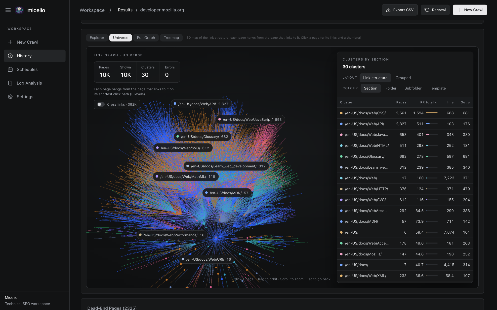
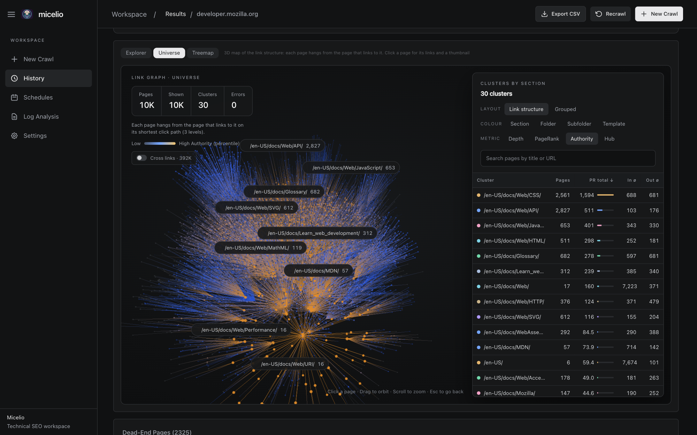
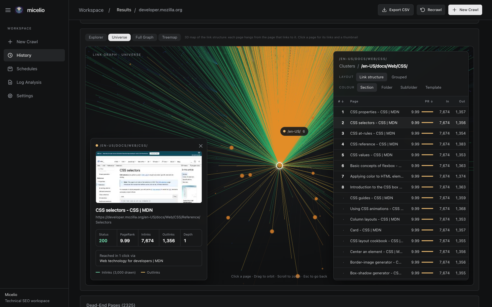
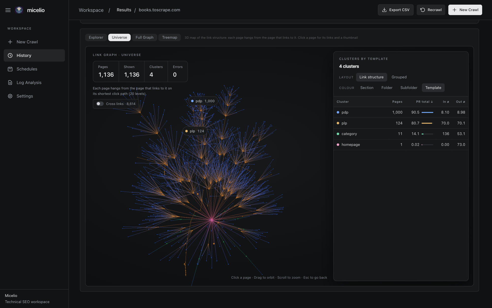

# Micelio User Guide

Micelio is a technical SEO crawler with two interfaces:

- The **web dashboard** is the best choice for interactive audits, live monitoring,
  visual analysis, crawl history, log analysis, and scheduled crawls.
- The **CLI** is the best choice for scripts, repeatable exports, head-only checks,
  and automation. See the [CLI reference](CLI-REFERENCE.md) for every command.

Both interfaces use the same Go crawler and analysis pipeline.

## Start the dashboard

```bash
micelio ui
# Open http://localhost:3100
```

The default listener is `127.0.0.1:3100`, so it is only reachable from the local
machine. If you bind it to another interface, protect the API with a bearer token:

```bash
micelio ui --host 0.0.0.0 --port 3100 --auth-token "$MICELIO_AUTH_TOKEN"
```

## Choose a workflow

| Goal | Start here | What to enable |
|---|---|---|
| Fast health check | New Crawl > Quick Scan | The preset is enough |
| Full technical audit | New Crawl > Technical Audit | JS rendering if the site depends on client-side rendering |
| Content and duplicate analysis | New Crawl > Content Audit | N-grams and embeddings |
| Internal-link audit | New Crawl > Internal Linking | Link Intelligence; also enable Discover Sitemaps for sitemap-only orphans |
| Crawl only known URLs | URL List or Sitemap mode | Use Sitemap for XML sitemap indexes and compressed sitemaps |
| Compare releases or migrations | History or Diff | Run a baseline and a follow-up crawl |
| Analyze crawler traffic | Log Analysis | Upload one or more access logs, then optionally merge with a crawl |
| Run recurring checks | Schedules | Add a cron expression and optional webhook |

## 1. Configure a crawl

Open **New Crawl**, choose a preset if useful, then choose a crawl mode.

### Crawl modes

| Mode | Input | Behavior | Best for |
|---|---|---|---|
| **Spider** | One seed URL | Follows eligible internal links up to the depth and page limits | Discovering a site from its navigation |
| **URL List** | One URL per line | Requests the supplied URLs without discovering more pages | QA lists, migrations, and known landing pages |
| **Sitemap** | One or more sitemap URLs | Resolves nested sitemap indexes and gzip files, then crawls exactly the listed page URLs | Coverage checks and complete known-URL audits |

Sitemap mode does **not** spider from the pages it downloads. A sitemap may be on
a different host or CDN from the pages it lists.

Spider mode can also enable **Discover Sitemaps**. That augments link discovery
with sitemap URLs and makes it possible to identify sitemap-listed orphan pages;
it is different from dedicated Sitemap mode.

### Quick-start presets

Presets fill the form but do not lock it. Review the limits and integrations
before starting, especially on production sites.

| Preset | Intended use | Important defaults |
|---|---|---|
| **Quick Scan** | Fast overview | Depth 1, 100 pages, HTML report |
| **Full Audit** | Broad enterprise audit | Up to 1M pages, adaptive rate, sitemap discovery, content/link/external checks |
| **Content Audit** | Copy quality and similarity | N-grams, embeddings, HTML report |
| **Technical Audit** | Crawlability, status, canonical, security, and performance checks | External links, link intelligence, page weight |
| **Internal Linking** | Site architecture and link opportunities | Link intelligence, embeddings, N-grams, sitemap output, up to 200 suggestions |

Features that call external APIs still need valid credentials. Selecting a preset
does not create or supply API keys.

### Basic crawl controls

- **Depth** limits how many link hops Spider mode follows from the seed.
- **Page Limit** is the crawl safety ceiling.
- **Concurrency** controls simultaneous requests.
- **Delay** adds a minimum delay between requests.

Use a conservative concurrency and delay for sites you do not control. Adaptive
rate limiting can react to server feedback; `delay factor` derives the gap from
recent response times.

### Advanced configuration

The New Crawl form groups advanced controls by purpose:

- **URL Filtering** — include/exclude regular expressions, path-only matching,
  allowed domains, and an inline pattern tester.
- **Robots.txt & Sitemaps** — respect or ignore robots rules, expose blocked
  internal URLs, and discover sitemap URLs during Spider crawls.
- **Rate Limiting & Safety** — maximum errors, timeout, adaptive rate, and memory
  limits.
- **HTTP** — user-agent presets, headers, cookies, proxy, stealth fingerprinting,
  and Tor circuit rotation.
- **JavaScript** — headless Chrome rendering, resource blocking, render timeout,
  DOM/render comparison, and page snippets.
- **Custom Extraction** — named CSS selectors and literal or regular-expression
  searches against page source.
- **AI Analysis** — a per-page prompt with OpenAI, Anthropic, or Ollama.
- **Performance & SEO** — external-link checking, page weight, PSI, CrUX, n-grams,
  embeddings, and report/sitemap generation.
- **Google Integrations** — Search Console, BigQuery bulk export, and GA4.
- **Link Intelligence** — centrality, orphan detection, and link suggestions.
- **Segmentation** — named URL-pattern groups for filtered reporting.
- **Output & Storage** — output format, HTML report, full anchor/resource detail,
  SQLite persistence, and resume behavior.

## 2. Monitor and control the crawl

The **Monitor** page receives live updates over WebSocket. It shows page counts,
status codes, response times, excluded-URL counters, and crawler errors.

Available controls:

- **Pause** stops scheduling new requests while preserving the current job.
- **Resume** continues a paused job.
- **Cancel** ends the job without completing the full analysis pipeline.
- **Stop & Analyze** stops discovery gracefully and runs post-crawl analysis on
  the pages already collected.

Running and paused crawls also appear in the sidebar, so concurrent jobs can be
opened directly. Persisted crawls can be resumed after an app restart with their
configuration editable before continuation.

## 3. Read crawl results

The Results overview summarizes crawl health, indexability, response codes,
templates, URL structure, structured data, security, and content quality. Use the
tabs for deeper analysis.

| Tab | What it answers |
|---|---|
| **All Pages** | Which exact URLs match a status, indexability state, template, classification, issue, or search term? |
| **Issues** | What needs attention, how severe is it, and which URLs are affected? |
| **Performance** | How fast are responses, what do PSI/CrUX show, and where is page weight or HTML size risky? |
| **Content** | Where are pages thin, duplicated, stale, hard to read, or structurally weak? |
| **Links** | How is authority distributed, where are dead ends/orphans, and which internal links are missing? |
| **Signals** | Which content and quality signals stand out across the crawl? |
| **AI Visibility** | What AI-search and citation-readiness signals are available? This tab appears when the crawl produced AI visibility data. |

### Page and issue exploration

The page table supports server-side search, sorting, pagination, issue filters,
template filters, and CSV export. Template filters also recalculate the visible
summary so a section of the site can be evaluated independently.

Micelio checks technical and content signals including titles, descriptions,
headings, canonical chains and loops, robots directives, hreflang return links,
structured data, Open Graph/Twitter tags, security headers, redirects, soft 404s,
duplicate content, URL structure, image metadata, and Googlebot's 2 MB HTML
truncation risk.

**Soft-404 candidates** are pages that answer 200 (or redirect) but show no real
content. At the start of a crawl Micelio requests one URL that cannot exist: if
the site answers 200, pages that look like that "not found" page are flagged.
It also flags listings with no product or ad links while similar listings have
them (low confidence alone, since some sites load products with JavaScript; high
with "no results" wording), "not found" or "0 results" wording in eight languages, deep URLs redirected
to the home page, many URLs redirected to one page, and pages with far less text
than their template. Each candidate has a confidence (high, medium, low) and its
reasons. They are candidates to review: Search Console's page indexing report
confirms. Turn the one extra request off with "Check how the site answers missing
pages" on New Crawl or `--no-soft404-probe`.

### Link Intelligence

Enable Link Intelligence before the crawl to compute the complete set of graph
metrics and suggestions.

- **Graph Explorer** starts at the home page and expands one level at a time. It
  reads neighborhoods from SQLite, which keeps exploration responsive on very
  large crawls. Search, breadcrumbs, collapse/expand, coverage, and Depth,
  Authority, Hub, and PageRank color modes are available.
- **Universe** draws the whole site as a 3D map of its internal links. See
  [Universe](#universe) below.
- Other views include the directory tree, site treemap, anchor cloud, PageRank
  distribution, dead ends, nofollow usage, links to non-indexable pages, orphan
  pages, and semantic link suggestions.

- The **directory tree** and **treemap** load one folder at a time. Open a
  folder to fetch its subfolders and pages, 100 at a time with **Load more**
  (300 per block in the treemap). Pages come first by PageRank.

#### Universe

Open **Links > Universe**. Every dot is a crawled page and every line is a real
internal link.



How the map is built:

- Micelio walks the links from the start page, one click level at a time. Each
  page is placed next to the page that links to it on its shortest click path.
  When several pages qualify, one from the same section wins, then the one with
  the highest PageRank. So two pages side by side are linked, and each branch
  is a chain of real links.
- Branches with more pages below them get more room.
- Pages the start page cannot reach by links sit on an outer shell, labelled
  **Not reachable from the start page**.
- Bigger, brighter dots have more PageRank. Red dots are 4xx/5xx pages.

Controls:

| Control | What it does |
|---|---|
| **Layout: Link structure / Grouped** | Link structure places pages by links (default). Grouped places each cluster around its own centre, with lines between clusters showing real link counts. |
| **Colour: Section / Folder / Subfolder / Template** | Colours pages by group. Section finds the folder most of the site shares (for example `/en-US/docs/Web/`) and groups by the folder below it. |
| **Metric: Depth / PageRank / Authority / Hub** | Colours pages by a metric instead. Depth uses one colour per click level; the others go from grey (low) to gold (high). Authority and hub are shown as percentiles, since a few pages hold most of the score. Click the active metric again to go back to group colours. |
| **Search** | Find a page by title or URL. Press Enter or pick a result to fly to it and open its details. |
| **Cross links** | Adds the links that are not part of the click-path tree. Off by default, since on large sites they hide the structure. |
| **Menu, footer & section nav links** | Adds links to navigation pages: pages linked from 40%+ of the site or from half of their own section. Off by default. |
| **Cluster table** | Click a row to fly to that cluster. The table switches to its pages, sortable by PR, inlinks and outlinks. |



Click a dot or a table row to select a page. The panel shows its status,
PageRank, inlinks, outlinks and depth, how many clicks it takes to reach and
through which page, and a thumbnail. Its inlinks are drawn in green and its
outlinks in amber. **Open in Explorer** switches to Graph Explorer with that page
open, to study its links one level at a time.



Thumbnails are captured with headless Chrome the first time you open a page
and cached in `~/.micelio/ui/thumbs/`. Without Chrome the panel shows no
thumbnail. Deleting a crawl removes its thumbnails.

Large crawls: Universe loads the first 10,000 pages by PageRank, then keeps
loading until it reaches a limit set by the device (memory, CPU cores, GPU) or
a frame takes longer than 14 ms. The panel says how many pages and links are
drawn and what limited them. A 1M-page crawl draws in a few seconds on a recent
laptop.



The example above is a small shop: the home page (pink) leads to paginated
listings (amber), and each listing to its products (blue). The long amber chain
is pagination: some products sit 20 clicks from the home page.

Centrality is relatively expensive. Use **Skip Centrality** for very large crawls
when discovery and basic link counts matter more than PageRank/authority metrics.

### Signals

The **Signals** tab groups content and quality signals by page: EEAT and
content-richness indicators, AI and passage readiness, topicality, freshness,
and structured-data coverage. Treat them as crawl-time proxies to validate
against Search Console, analytics, or logs, not as ranking facts.

## 4. Compare and automate

### History and Diff

**History** lists completed and active crawls, supports status filters, and starts
side-by-side comparison. **Diff** tracks added, removed, and changed URLs plus
changes in visibility, segments, lifecycle, topics, and cannibalization signals.

For a reliable comparison, keep crawl mode, limits, filters, user agent, rendering,
and integrations consistent between the baseline and follow-up runs.

### Schedules

**Schedules** runs crawls on a cron schedule. To schedule a full setup, configure
it on **New Crawl** and click **Schedule…**: the schedule keeps every option
(mode, filters, rate, extractions…). The Schedules page also has a quick form.

- Each run is a normal crawl in **History**, tagged with its schedule, so you can
  open it, compare it with Diff and get alerts. **Open crawl →** jumps to the
  latest run.
- Schedules are saved and resume when Micelio restarts.
- **Only run when…**: list allowed public IP ranges (CIDR or IP). The check runs
  before each run (a failing check skips the run and shows why) and every minute
  while crawling: the crawl pauses until it passes again and stops, with
  analysis, after 6 hours paused. **Test check** runs it on demand.
- A webhook (Slack or any URL) is called after each run, including skipped and
  stopped runs, with the reason.

Use page/error/time limits so an unexpected site change cannot create an
unbounded recurring crawl.

From the CLI, `micelio schedule --config site.json` uses a crawl config in the
same JSON format the dashboard sends. Add `--precheck-egress <CIDR>` or
`--precheck-cmd "<command>"` for checks, and `--check-only` to test them once.
`micelio schedules` lists schedules.

### Import a crawl made elsewhere

**History → Import crawl…** (or `micelio import <file>`) adds a crawl made with
`micelio crawl` to History and runs the dashboard's analysis on this computer:
stats, issues, PageRank, Universe and the directory tree. It takes the crawl
database (`--db`) or the JSONL output (`.jsonl`, `.gz`, `.zst`). This lets a small
cloud server crawl with `--no-analysis --db-only` while your computer does the
heavy work. See [Crawl in the cloud](CLOUD-CRAWLS.md).

## 5. Analyze server logs

Open **Log Analysis** to upload one or more files. Micelio processes files in
parallel, auto-detects common formats, and presents progress while parsing.

Supported inputs include Apache Combined/CLF, Nginx, AWS CloudFront, Cloudflare
JSON, ALB/ELB, and W3C/IIS. Results cover:

- human and bot activity, including search, AI training, AI search, social, SEO,
  monitoring, and other crawler families;
- URL, directory, status, hourly, daily, trend, and heatmap views;
- crawl-budget waste, redirect and error patterns, and anomalies;
- Google crawler variants and optional IP verification;
- AI-bot trends; and
- a log-to-crawl merge.

The merge classifies URLs into seven operational segments: healthy,
crawled-not-indexed, uncrawled-indexable, orphan-crawled, crawl-waste,
redirect-waste, and error-pages. Start from a crawl of the same site and time
period for the most useful comparison.

For automation, use `micelio logs --json` to emit the summary as JSON to stdout,
or `micelio logs --output <path>` to write it to a file.

## 6. Configure integrations and defaults

**Settings** are stored in Micelio's local SQLite state. Secret values are masked
when read back by the API. Configure only the services needed for a crawl:

| Integration | Purpose | Required configuration |
|---|---|---|
| PageSpeed Insights | Lab performance metrics | PSI API key |
| CrUX | Field performance data | CrUX API key and form factor |
| Google Search Console | Queries, clicks, impressions, and visibility evidence | OAuth token or service-account file plus property |
| GSC BigQuery export | Bulk Search Console data | `project.dataset` |
| Google Analytics 4 | Traffic and engagement | Service-account file and property ID |
| Plausible | Sessions and conversions | Site ID, API key, and optional self-hosted URL |
| AI analysis | Prompt-based per-page analysis | Provider, model, key, and prompt; Ollama can run locally |
| Embeddings | Similarity and link opportunities | OpenAI key or a local Ollama model |
| Webhooks/Slack | Crawl alerts | Destination webhook URL |
| Email | Crawl report: alerts and changes since the previous crawl | SMTP host, port, user, password, sender, recipients |
| Telegram | The same crawl report | Bot token (@BotFather) and chat ID |

**Crawl reports** go to email, Telegram and Slack (Settings → Alert
Notifications). Each starts with up to five key points, then the alerts and the
changes. Telegram needs a bot from @BotFather: paste its token, message the bot
(or add it to a group or channel) and use "Find my chat". Reports arrive after a crawl
when it has critical or new alerts or an important change since the previous
crawl of the same schedule or site: pages crawled, 4xx/5xx responses, indexable
share, new soft-404 candidates, URLs no longer found. Each change lists up to 10
example URLs. Scheduled runs that are skipped or fail are emailed too. Tick "Email
a report after every crawl" for one after every run. Each channel has a test button.
From the CLI, `micelio schedule --email-to ... --smtp-host ... --smtp-from ...`
(password in `MICELIO_SMTP_PASSWORD`) and `--telegram-chat ...` (token in
`MICELIO_TELEGRAM_TOKEN`) report each run.

**Keep tokens and IDs out of git.** Values typed in Settings are stored in
`~/.micelio/ui/micelio-ui.db`, outside any repository. You can also put them in
`~/.micelio/micelio.env` (or the file named by `MICELIO_ENV_FILE`), which the
dashboard and the CLI read at start. Values saved in Settings win; blank fields
fall back to the file. Protect it with `chmod 600 ~/.micelio/micelio.env`.

```bash
# ~/.micelio/micelio.env
MICELIO_TELEGRAM_TOKEN=123456:ABC...
MICELIO_TELEGRAM_CHAT=123456789
MICELIO_SMTP_HOST=smtp.example.com
MICELIO_SMTP_PORT=587
MICELIO_SMTP_USER=alerts@example.com
MICELIO_SMTP_PASSWORD=app-password
MICELIO_SMTP_FROM=alerts@example.com
MICELIO_EMAIL_TO=you@example.com
MICELIO_SLACK_WEBHOOK=https://hooks.slack.com/services/...
MICELIO_ALERT_WEBHOOK=https://example.com/hook
MICELIO_DASHBOARD_URL=http://127.0.0.1:3100
```

Settings also define default crawl limits, robots behavior, user agent, content
analysis, link intelligence, output, and alerts. A selected New Crawl preset can
override those form defaults.

## 7. Update or roll back Micelio

Tagged release builds check GitHub release metadata at most once every 24 hours.
When a compatible update is available, the dashboard shows a banner and the
Settings page shows the current/latest versions and platform.

The update flow:

1. Downloads the release asset matching the current OS and architecture.
2. Verifies it against the release `checksums.txt` when that file is available.
3. Preserves the running binary as a backup and atomically installs the new one.
4. Requires a Micelio restart before the new binary is used.

Until the backup is replaced or removed, **Rollback** restores it; restart again
after rolling back. Development builds do not self-update. If a release has no
asset for the current platform, install it manually.

## 8. Outputs and local data

Depending on the selected options, Micelio can produce:

- streaming JSONL or CSV page data;
- a self-contained interactive HTML report;
- an XML sitemap containing eligible indexable pages;
- SQLite crawl state for the dashboard, graph exploration, persistence, and
  resume; and
- JSON summaries from log analysis and crawl comparisons.

`--no-db` disables automatic crawl database creation for CLI Spider crawls, but
also removes persistence-dependent features such as resume. `--resume` and
`--no-db` cannot be used together.

## Troubleshooting

- Run `micelio <command> --help` to confirm options and defaults for the installed
  version.
- If JS-rendered content is missing, confirm Chrome/Chromium is installed and
  increase the render timeout.
- If an integration is empty, verify that it was enabled for that crawl as well
  as configured in Settings.
- If results are incomplete, check page/depth limits, include/exclude patterns,
  robots rules, allowed domains, timeouts, and the Monitor error list.
- If Sitemap mode returns fewer pages than expected, inspect nested sitemap
  responses, compression, and the optional page limit; it intentionally does not
  discover links from crawled pages.
