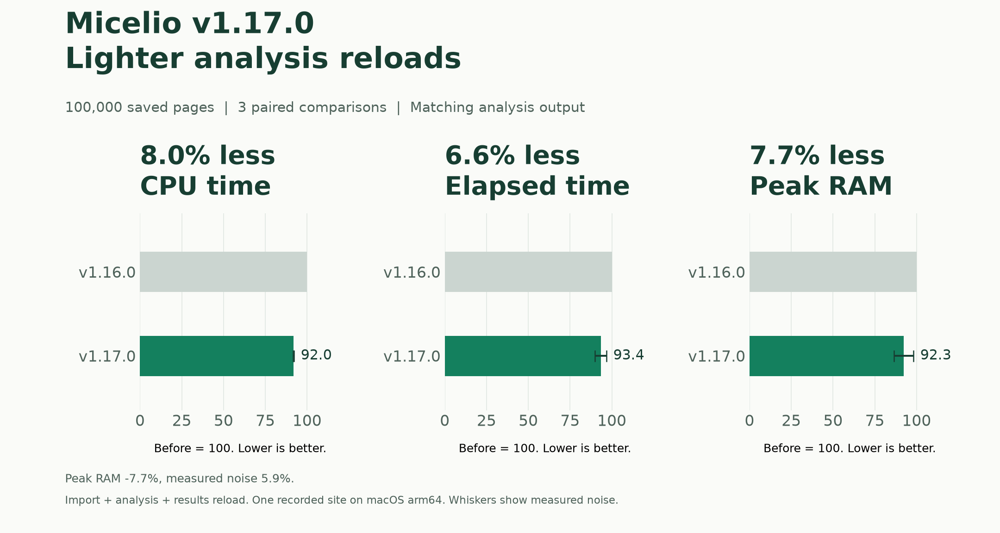

# v1.17.0 reload measurements

The public v1.17.0 engine used 8.0% less CPU time and 6.6% less elapsed time than the v1.16.0 engine in a recorded 100,000-page saved-crawl workflow. The workflow includes import, analysis and reopening results. All measured runs produced identical output.

## Method

- Three reference pairs measured the noise floor. Three further pairs compared the public baseline and candidate.
- Both sides used the same recorded pages and HTTP responses. Replay support was added only to benchmark builds and is absent from the release binaries.
- CPU and elapsed time cover the timed workflow. Output comparison starts after both timed windows end.
- Output is compared after normalizing clocks, measured durations, clock-dependent freshness ages, temporary database paths and random probe suffixes. Non-integer values use 12 significant digits. SEO lists retain their order.
- Changes below 3% or below measured noise are not treated as demonstrated gains here.
- Percentages use the median of per-pair ratios. Noise includes the larger of the comparison spread and the fresh reference noise floor. The chart whiskers are noise bounds, not confidence intervals.
- Peak RAM fell 7.7% with 5.9% measured noise.

This is one recorded site on one machine. The recording is not redistributed. Network requests, JavaScript rendering and live sites can give different results. The figure measures the combined release change; it does not add percentages from earlier experiments.

[Raw measurements and source hashes](release-1.17-reload.json). [Vector chart](../img/release-1.17-reload.svg).
