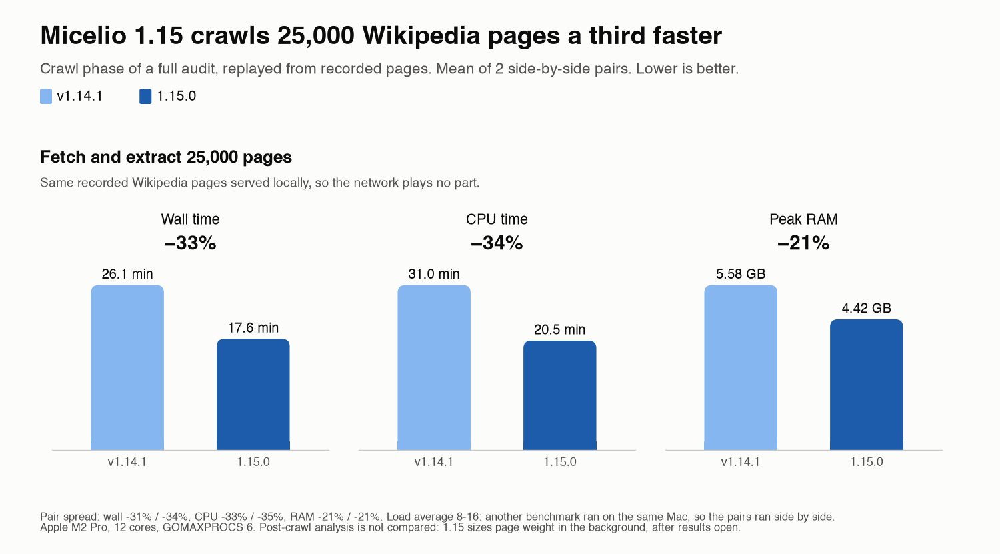

# Micelio 1.15.0

Results open sooner, crawls use less CPU and memory, and you can stop the slow work that runs after a crawl.

## Faster and lighter

We replayed a 25,000-page Wikipedia crawl with both versions. The same recorded pages are served from this computer, so the network plays no part. Full audit settings: page weight, n-grams, link intelligence, external links. Two pairs, each pair run side by side so machine load hits both versions alike.

Crawl phase (fetch and extract 25,000 pages), mean of the 2 pairs:

| | 1.14.1 | 1.15.0 | Change |
|---|---|---|---|
| Wall time | 26.1 min | 17.6 min | -33% |
| CPU time | 31.0 min | 20.5 min | -34% |
| Peak RAM | 5.58 GB | 4.42 GB | -21% |

In a real crawl of 10,000 Wikipedia articles, the page-weight step went from 1 h 52 min to 39 min, with the same 23,664 resources sized.

Where it comes from:

- **Page weight is polite and fast.** Each host gets its own queue. The crawled site keeps the crawl's delay; image CDNs get up to 10 requests per second instead of the crawl delay. A host that answers 429 or 503 is slowed down, and sizes are no longer lost.
- **Less work per page.** Plain text matching instead of large regular expressions, one HTML parse per page instead of two, word lists matched in one pass.
- **Less memory when results load.** Repeated strings (resource URLs, headings) are stored once, fields the dashboard never reads are skipped, anchors are streamed.
- **Smaller temp file.** The internal-links file written during a crawl is zstd-compressed, about 10 times smaller.

## New

- **Stop or cancel background work from Results.** After a crawl, the external link check, page weight and link intelligence run in the background, and Results shows them in one strip. **Stop external link check** ends only the network checks. **Cancel background analysis** stops everything; the results you see stay, with a note that the analysis was interrupted.
- **Images are not downloaded by default.** JS rendering blocks image requests and links to image files are not crawled. Turn it on in **Settings → Images**, in New Crawl or with `--download-images`. Page weight still sizes every image, so totals stay comparable with Lighthouse.
- **New issue: HTML over 2 MB.** Pages whose HTML is bigger than Googlebot's 2 MB fetch limit, in Issues, the HTML and PDF reports and MCP `crawl_summary`.
- Crawl coverage settings show as compact tiles.

## Fixed

- **Cancel and Stop & Analyze work after fetching ends.** Before, they answered "crawl has finished" while page weight, the external check and link intelligence kept running.
- **The same crawl gives the same results.** Lists with ties (top pages, n-grams, link suggestions, directory tree, crawl comparison, log top URLs) now have a fixed order.
- Plus the fixes listed in the changelog: more blocked address ranges, Search Console and GA4 paging, safer output rewrites, schedule and restart races, and updated dependencies.

## Heads-up for scripts that read the JSONL

Each image entry now holds only `src`, `alt`, `width`, `height` and, for long inline images, `inlineBytes`. The derived fields (missing alt, missing size and so on) are gone; compute them from those four. `src` is the URL the page serves, query string kept. Older crawls still load. See [section 8 of the user guide](../USER-GUIDE.md).

## Notes on the numbers

- Apple M2 Pro, 12 cores, each run limited to 6 cores (GOMAXPROCS 6). Another benchmark ran on the same Mac (load average 8 to 16), which is why each pair ran side by side. The two pairs agree within 3 points (wall -31% and -34%, CPU -33% and -35%, RAM -21% both).
- Only the crawl phase is compared. 1.15.0 sizes page weight in the background after results open, so the work after the crawl is not the same in both runs.
- 1.15.0 stores less per image and adds the `html-over-2mb` stats, so the two versions do not write identical data. 4 of the 25,000 pages differ: 1.15.0 does not crawl links that end in an image extension (for example `Special:WhatLinksHere/File:photo.jpg`) unless image downloads are on.
